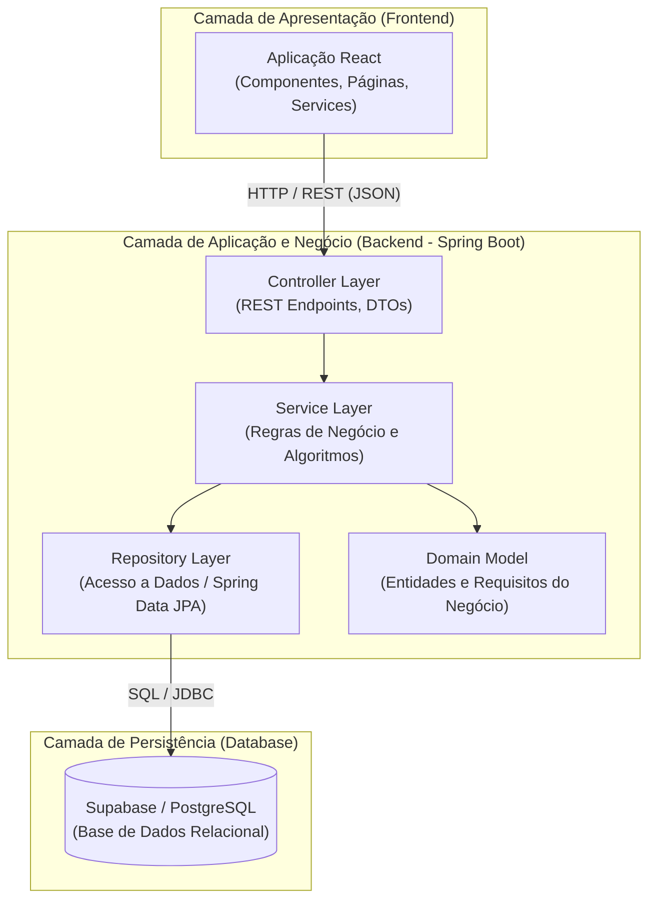

# Arquitetura da Aplicação — StudyMatch

> Sprint 1 · Issue #6

## 1. Visão Geral+

O **StudyMatch** adota uma arquitetura em camadas baseada no padrão **Client-Server (API REST)**, promovendo a separação clara de responsabilidades entre a interface com o utilizador, a lógica de negócio e a persistência de dados.

## 2. Componentes e Responsabilidades

### 2.1. Frontend (React)
- **Responsabilidade:** Fornecer uma interface intuitiva para Estudantes e Docentes.
- **Componentes:**
  - **Páginas / Componentes:** Gestão de vistas (Registo, Quiz, Perfil Radar, Contextos e Grupos).
  - **Services / API Layer:** Módulos responsáveis por efetuar chamadas HTTP (REST) ao Backend.

### 2.2. Backend (Spring Boot)
- **Controller Layer:** Expõe os *endpoints* REST, recebe os pedidos HTTP, valida os DTOs de entrada e devolve as respostas em formato JSON.
- **Service Layer:** Contém toda a lógica de aplicação e orquestração das operações.
- **Domain Layer:** Define as entidades do modelo de domínio (ex.: `Estudante`, `Inscricao`, `Competencia`, `Grupo`).
- **Repository Layer:** Abstrai o acesso à base de dados através de interfaces Spring Data JPA.

### 2.3. Base de Dados (Supabase)
- **Responsabilidade:** Persistir e gerir os dados relacionais da aplicação (PostgreSQL), garantindo integridade referencial e segurança.

## 3. Comunicação Frontend ⇄ Backend

- **Protocolo:** A comunicação é estritamente assíncrona sobre HTTP/HTTPS utilizando **JSON** como formato de intercâmbio de dados.
- **Data Transfer Objects (DTOs):** A transferência de dados entre a camada de apresentação e os *controllers* é realizada via DTOs (ex.: `RegistoEstudanteDTO`, `RespostaQuizDTO`, `GrupoGeradoDTO`).
- **Autenticação:** As rotas protegidas utilizam tokens para autenticar as requisições dos utilizadores.

## 4. Onde Ficam as Regras de Negócio

Todas as regras de negócio e validações lógicas residem no **Backend**, distribuídas entre as camadas **Service** e **Domain**:

1. **Service Layer (Serviços):**
   - **Algoritmo de Serpentina (UC11):** Distribuição equilibrada de alunos pelos grupos com base nas médias dos seus perfis.
   - **Cálculo de Transição Quiz → Histórico (UC09):** Aplicação da fórmula `pesoQuiz = max(0, 1 - n/N)` para calcular o nível ponderado.
   - **Validações e Ações (UC01, UC03, UC10):** Unicidade de email/nº de estudante, validação de notas (0–20) e atribuição de papéis.

2. **Domain Layer (Entidades e Value Objects):**
   - Encapsulamento de invariantes do domínio (ex.: regras do `EmailInstitucional`, cálculo interno do estado de aprovação da `Nota`).

## 5. Abordagem de Persistência

- **Tecnologia:** Base de dados relacional gerida no **Supabase** (PostgreSQL).
- **Mapeamento ORM:** Utilização de **Spring Data JPA / Hibernate** no Backend Java para mapear automaticamente as entidades do modelo de domínio para as tabelas da base de dados.
- **Transacionalidade:** Gestão de transações ao nível da camada de *Service* (anotação `@Transactional`), garantindo que operações complexas (ex.: guardar submissão do quiz + atualizar perfil) ocorrem de forma atómica.