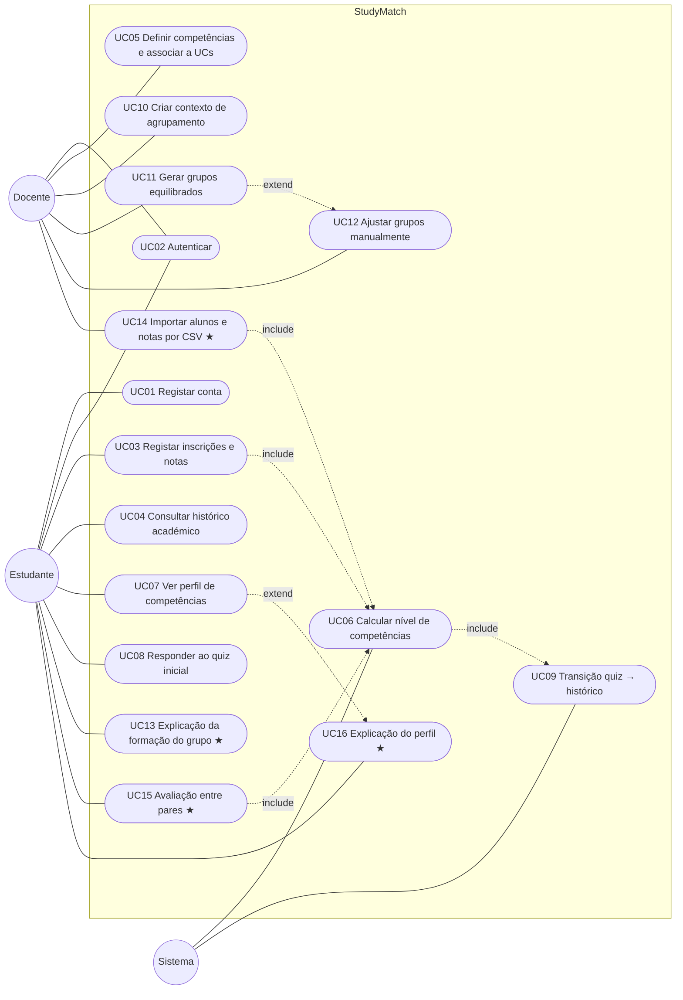

# Modelo de Casos de Uso — StudyMatch

> Sprint 1 · Issue #4 · Grupo 2 — atualizado no Sprint 2 (Issue #51: UC06/RN13 e novo UC16)
> Documento vivo: os casos de uso vão evoluir nos próximos sprints.

## 1. Objetivo

Este documento descreve o modelo inicial de casos de uso do StudyMatch. Cobre as seis áreas obrigatórias do enunciado e quatro casos de uso criativos propostos pela equipa (o UC16 foi acrescentado no Sprint 2). Cada caso de uso tem o objetivo, os atores, o cenário principal, os fluxos alternativos, as regras de negócio e os conceitos de domínio que revela. Esses conceitos alimentam o [modelo de domínio](modelo-dominio.md).

## 2. Atores

| Ator | Tipo | Descrição |
|---|---|---|
| **Estudante** | Primário | Aluno inscrito num curso. Regista o seu percurso académico, responde ao quiz, consulta o perfil e participa em grupos. |
| **Docente** | Primário | Professor de uma ou mais UCs. Define competências, cria contextos de agrupamento, gera e ajusta grupos e importa dados. |
| **Sistema** | Secundário (interno) | Processos automáticos: cálculo de níveis de competência, transição quiz → histórico, recálculo do perfil. |

## 3. Diagrama de casos de uso

★ = caso de uso criativo (proposto pela equipa)

## 4. Mapa de cobertura

| Área do enunciado | Casos de uso | Issues |
|---|---|---|
| Identidade do estudante | UC01, UC02 | #12, #13 |
| Trajetória académica | UC03, UC04 | #14, #15 |
| Competências | UC05, UC06 | #16, #17 |
| Perfil do estudante | UC07 | #18 |
| Arranque a frio (*cold start*) | UC08, UC09 | #19, #20 |
| Contexto de agrupamento | UC10, UC11, UC12 | #21, #22, #23 |
| **Criativos** | UC13, UC14, UC15, UC16 | #24, #25, #26, #39 |

---

## 5. Casos de uso

### Área 1 — Identidade do estudante

#### UC01 — Registar conta de estudante · [#12]

**Objetivo:** o estudante cria a conta para passar a ter perfil no StudyMatch.
**Ator primário:** Estudante

**Cenário principal**
1. O estudante abre a página de registo.
2. Preenche o nome, o nº de estudante, o email institucional, o curso, o ano e a password.
3. O sistema valida os dados.
4. O sistema cria a conta e um perfil de competências vazio.
5. O sistema informa que a conta foi criada e sugere responder ao quiz inicial (UC08).

**Fluxos alternativos / exceções**
- **3a.** O email não pertence ao domínio da universidade → o sistema rejeita e indica o domínio aceite.
- **3b.** O nº de estudante ou o email já existem → o sistema rejeita e sugere iniciar sessão.
- **3c.** Falta um campo obrigatório ou o formato é inválido → o sistema assinala o campo.

**Regras de negócio**
- RN01: o nº de estudante e o email são únicos.
- RN02: só são aceites emails do domínio institucional (ex.: `@upt.pt`).
- RN03: a password tem pelo menos 8 caracteres e é guardada apenas em *hash*.

**Conceitos de domínio:** Estudante, Utilizador, Curso, Email institucional, Perfil de competências.

---

#### UC02 — Autenticar · [#13]

**Objetivo:** o utilizador inicia sessão para aceder às funcionalidades do seu papel.
**Atores primários:** Estudante, Docente

**Cenário principal**
1. O utilizador introduz o email e a password.
2. O sistema valida as credenciais.
3. O sistema inicia a sessão e mostra a área correspondente ao papel (estudante ou docente).

**Fluxos alternativos / exceções**
- **2a.** As credenciais são inválidas → mensagem genérica de erro (sem dizer qual dos campos falhou).
- **2b.** 5 tentativas falhadas seguidas → a conta fica bloqueada temporariamente.

**Regras de negócio**
- RN04: cada utilizador tem exatamente um papel: Estudante ou Docente.
- RN05: só o Docente pode gerir competências, contextos e grupos; o Estudante só acede aos seus próprios dados.

**Conceitos de domínio:** Utilizador, Papel.

---

### Área 2 — Trajetória académica

#### UC03 — Registar inscrições e notas · [#14]

**Objetivo:** o estudante regista as UCs em que se inscreveu e as notas que teve, para o histórico contar para o perfil.
**Ator primário:** Estudante · **Ator secundário:** Sistema

**Cenário principal**
1. O estudante escolhe uma UC do seu curso.
2. Indica o ano letivo, o semestre e a nota obtida.
3. O sistema determina o nº da tentativa (1.ª, 2.ª, …) para essa UC.
4. O sistema guarda a inscrição e marca-a como aprovada (nota ≥ 10) ou reprovada.
5. O sistema recalcula os níveis de competência (UC06).

**Fluxos alternativos / exceções**
- **2a.** Nota fora de 0–20 → rejeitada.
- **2b.** A inscrição ainda não tem nota (UC em curso) → fica com o estado "em curso" e não conta para as competências.
- **2c.** Já existe uma inscrição na mesma UC e no mesmo ano letivo/semestre → o sistema pede confirmação de que é uma nova tentativa (época especial ou melhoria).

**Regras de negócio**
- RN06: a nota é um inteiro de 0 a 20; aprovação com nota ≥ 10.
- RN07: várias tentativas na mesma UC ficam todas registadas (histórico completo).
- RN08: para o cálculo de competências conta a **melhor nota** obtida em cada UC.

**Conceitos de domínio:** Inscrição, Tentativa, Nota, Unidade Curricular, Ano letivo, Semestre, Estado da inscrição.

---

#### UC04 — Consultar histórico académico · [#15]

**Objetivo:** o estudante vê o seu percurso por ano e semestre para acompanhar a progressão.
**Ator primário:** Estudante

**Cenário principal**
1. O estudante abre "O meu histórico".
2. O sistema mostra as inscrições agrupadas por ano letivo e semestre, com a UC, os ECTS, a tentativa, a nota e o estado.
3. O sistema mostra a média atual e os ECTS concluídos.

**Fluxos alternativos / exceções**
- **2a.** Sem inscrições → mensagem a sugerir o registo de notas (UC03) ou o quiz (UC08).

**Regras de negócio**
- RN09: a média é ponderada pelos ECTS e só conta UCs aprovadas (melhor nota de cada UC).

**Conceitos de domínio:** Histórico académico, Inscrição, ECTS, Média.

---

### Área 3 — Competências

#### UC05 — Definir competências e associá-las a UCs · [#16]

**Objetivo:** o docente define competências e associa-as a UCs com um peso, para as notas alimentarem as competências dos alunos.
**Ator primário:** Docente

**Cenário principal**
1. O docente cria uma competência (nome, descrição).
2. Associa-a a uma ou mais UCs, indicando o peso de cada associação.
3. O sistema guarda a competência e as associações.
4. O sistema recalcula os níveis dos alunos afetados (UC06).

**Fluxos alternativos / exceções**
- **1a.** Já existe uma competência com o mesmo nome → rejeitada.
- **2a.** Peso fora do intervalo ]0, 1] → rejeitado.
- **1b.** Editar uma competência existente → as alterações aplicam-se e os níveis são recalculados.

**Regras de negócio**
- RN10: todas as competências usam a mesma escala de **1 a 5**.
- RN11: o peso indica quanto a nota de uma UC contribui para a competência (0 < peso ≤ 1).
- RN12: há 4 competências base, pré-definidas e não eliminadas, que correspondem às áreas do quiz: *Organização*, *Gestão de tempo*, *Programação* e *Trabalho em grupo*.

**Conceitos de domínio:** Competência, Associação Competência–UC, Peso, Escala de nível.

---

#### UC06 — Calcular nível de competências · [#17]

**Objetivo:** converter as notas do aluno em níveis de competência para construir o perfil automaticamente.
**Ator primário:** Sistema
**Disparado por:** UC03, UC05, UC14, UC15

**Cenário principal**
1. O sistema obtém, para cada competência, as UCs associadas e respetivos pesos.
2. Para cada UC em que o aluno foi aprovado, usa a melhor nota.
3. Converte essa nota para nível (1–5) (RN13).
4. Calcula a média dos níveis ponderada pelos pesos das UCs.
5. Combina o resultado com o quiz (UC09) e, na competência *Trabalho em grupo*, com a avaliação entre pares (UC15).
6. Atualiza o perfil do aluno.

**Fluxos alternativos / exceções**
- **2a.** O aluno não tem notas em nenhuma UC associada à competência → o nível vem só do quiz; se também não houver quiz, fica "sem dados".

**Regras de negócio**
- RN13: `nivel = 1 + 4 × (nota − 10) / 10` para notas aprovadas (10 → 1, 20 → 5); arredondamento só na apresentação. *Alterada no Sprint 2: ver [ADR-002](decisions/ADR-002-perfil-e-cold-start.md), D4.*
- RN14: o recálculo é automático sempre que muda uma nota, um peso ou uma avaliação.

**Conceitos de domínio:** Nível de competência, Origem do nível (quiz / histórico / pares), Perfil de competências.

---

### Área 4 — Perfil do estudante

#### UC07 — Ver perfil de competências · [#18]

**Objetivo:** o estudante vê o seu perfil para perceber os pontos fortes e fracos.
**Ator primário:** Estudante

**Cenário principal**
1. O estudante abre "O meu perfil".
2. O sistema mostra um gráfico radar com o nível (1–5) de cada competência.
3. Para cada competência, indica a origem do valor (quiz, histórico ou misto) e a percentagem de cada fonte.
4. Mostra a média geral do perfil.

**Fluxos alternativos / exceções**
- **2a.** O perfil está vazio (sem quiz nem notas) → convite para responder ao quiz (UC08).

**Regras de negócio**
- RN15: a média geral do perfil é a média simples dos níveis das competências com dados.
- RN16: o estudante só vê o seu próprio perfil; o docente vê os perfis dos alunos das suas UCs.

**Conceitos de domínio:** Perfil de competências, Nível de competência, Origem.

---

### Área 5 — Arranque a frio (*cold start*)

#### UC08 — Responder ao quiz inicial · [#19]

**Objetivo:** o estudante sem histórico responde a um quiz para ter perfil desde o primeiro dia.
**Ator primário:** Estudante

**Cenário principal**
1. O estudante abre o quiz inicial.
2. O sistema apresenta 20 perguntas, 5 por área: organização, gestão de tempo, programação e trabalho em grupo.
3. O estudante responde a cada pergunta numa escala de 1 a 5.
4. O estudante submete o quiz.
5. O sistema calcula o resultado por área (média das 5 respostas, de 1 a 5).
6. O sistema guarda o resultado e atualiza o perfil (UC06).

**Fluxos alternativos / exceções**
- **4a.** Faltam respostas → a submissão é bloqueada e as perguntas em falta são assinaladas.
- **1a.** O estudante já respondeu ao quiz → pode repeti-lo no máximo uma vez por semestre; fica o resultado mais recente.

**Regras de negócio**
- RN17: o quiz só é aceite completo (20/20 respostas).
- RN18: o resultado por área é a média das respostas dessa área, na escala 1–5.

**Conceitos de domínio:** Quiz, Pergunta, Área, Submissão do quiz, Resposta, Resultado por área.

---

#### UC09 — Transição do quiz para o histórico · [#20]

**Objetivo:** reduzir o peso do quiz à medida que o aluno acumula notas, para o perfil refletir dados reais.
**Ator primário:** Sistema
**Disparado por:** UC06

**Cenário principal**
1. O sistema conta as UCs concluídas (aprovadas) pelo aluno: `n`.
2. Calcula o peso do quiz: `pesoQuiz = max(0, 1 − n / N)`, com `N = 6` por omissão (configurável).
3. Para cada competência base, combina: `nivel = pesoQuiz × nivelQuiz + (1 − pesoQuiz) × nivelHistorico`.
4. Guarda o nível e a origem no perfil.

**Fluxos alternativos / exceções**
- **1a.** `n = 0` → perfil = 100% quiz.
- **3a.** Não há `nivelHistorico` para a competência → usa só o quiz, mesmo com `n > 0`.
- **3b.** Não há quiz → usa só o histórico.

**Regras de negócio**
- RN19: sem notas, o perfil é 100% quiz; com `N` ou mais UCs concluídas, é 100% histórico.
- RN20: a regra está documentada aqui e tem de ter testes unitários (critério de aceitação do #20).

**Exemplo:** um aluno com 3 UCs concluídas → `pesoQuiz = 1 − 3/6 = 0,5`. Com quiz = 4,0 e histórico = 3,0, o nível fica `0,5 × 4,0 + 0,5 × 3,0 = 3,5`.

**Conceitos de domínio:** Peso do quiz, Nível de competência, Origem.

---

### Área 6 — Contexto de agrupamento

#### UC10 — Criar contexto de agrupamento · [#21]

**Objetivo:** o docente cria o contexto onde os grupos vão ser formados.
**Ator primário:** Docente

**Cenário principal**
1. O docente escolhe a UC.
2. Indica o nome da atividade (ex.: "Projeto final") e o tamanho do grupo.
3. Seleciona os alunos participantes (por omissão, todos os inscritos na UC no ano letivo atual).
4. O sistema valida e guarda o contexto.

**Fluxos alternativos / exceções**
- **4a.** O nº de alunos não é múltiplo do tamanho → aviso: indica quantos grupos ficam com um elemento a mais ou a menos e deixa continuar.
- **4b.** Tamanho do grupo < 2 ou maior que o nº de alunos → rejeitado.
- **3a.** Alunos importados por CSV (UC14).

**Regras de negócio**
- RN21: nº de grupos = `ceil(nAlunos / tamanho)`. O resto distribui-se para os grupos ficarem com tamanhos que diferem no máximo em 1.
- RN22: cada contexto pertence a uma UC e a um docente.

**Conceitos de domínio:** Contexto de agrupamento, Atividade, Tamanho do grupo, Participante.

---

#### UC11 — Gerar grupos equilibrados · [#22]

**Objetivo:** gerar grupos automaticamente, equilibrados em competências.
**Ator primário:** Docente

**Cenário principal**
1. O docente abre um contexto de agrupamento e pede "Gerar grupos".
2. O sistema obtém a média do perfil de cada aluno participante.
3. Ordena os alunos por média, por ordem decrescente.
4. Distribui-os em **serpentina** (*snake draft*): G1, G2, …, Gk, Gk, …, G2, G1, G1, G2, …
5. Calcula e mostra a média de cada grupo e a diferença entre a maior e a menor.
6. O docente confirma e os grupos ficam guardados.

**Fluxos alternativos / exceções**
- **2a.** Há alunos sem perfil → o sistema avisa e coloca-os no fim da ordenação com média neutra (3,0).
- **5a.** A diferença entre médias ultrapassa o limite → aviso ao docente, que pode ajustar (UC12) ou aceitar.
- **6a.** O docente gera de novo → os grupos anteriores não confirmados são substituídos.

**Regras de negócio**
- RN23: a ordenação usa a média geral do perfil (RN15); em caso de empate, ordem alfabética.
- RN24: limite de equilíbrio: diferença máxima entre médias de grupos ≤ **0,5** (configurável por contexto).

**Exemplo (10 alunos, 2 grupos de 5):** ordem H, F, G, E, C, D, I, B, A, J → G1, G2, G2, G1, G1, G2, G2, G1, G1, G2. Resultado: G1 = {H, E, C, B, A}, G2 = {F, G, D, I, J}, com médias 14,2 e 13,8 em notas (praticamente iguais).

**Conceitos de domínio:** Grupo, Membro do grupo, Média do grupo, Distribuição em serpentina.

---

#### UC12 — Ajustar grupos manualmente · [#23]

**Objetivo:** o docente troca alunos entre grupos para corrigir casos específicos.
**Ator primário:** Docente
**Estende:** UC11

**Cenário principal**
1. O docente seleciona dois alunos de grupos diferentes.
2. Pede a troca.
3. O sistema troca os alunos e recalcula as médias dos dois grupos.
4. O sistema mostra se o equilíbrio (RN24) se mantém.

**Fluxos alternativos / exceções**
- **3a.** A troca quebra o limite de equilíbrio → aviso; o docente pode manter ou desfazer.
- **1a.** Mover um aluno sem troca → só é permitido se o tamanho dos grupos continuar a respeitar a RN21.

**Regras de negócio**
- RN25: os ajustes manuais ficam registados (quem, quando e que alunos).

**Conceitos de domínio:** Grupo, Ajuste manual.

---

## 6. Casos de uso criativos

### UC13 — Explicação da formação do grupo ★ · [#24]

**Objetivo:** o estudante percebe porque ficou naquele grupo, o que aumenta a confiança no processo.
**Ator primário:** Estudante
**Justificação:** a transparência aumenta a aceitação dos grupos e reduz os pedidos de troca.

**Cenário principal**
1. O estudante abre o seu grupo num contexto.
2. O sistema mostra o ponto mais forte de cada membro, por área (ex.: "Programação"), sem mostrar notas nem níveis exatos.
3. O sistema mostra um radar do grupo comparado com a média dos outros grupos.
4. O sistema explica o método em linguagem simples ("grupos formados por serpentina para equilibrar competências").

**Fluxos alternativos / exceções**
- **1a.** Os grupos ainda não foram confirmados pelo docente → a explicação não está disponível.

**Regras de negócio**
- RN26: nunca se expõem notas nem níveis numéricos individuais de outros alunos; apenas a área mais forte.

**Conceitos de domínio:** Grupo, Perfil de competências, Explicação.

---

### UC14 — Importar alunos e notas por CSV ★ · [#25]

**Objetivo:** o docente importa alunos e notas de um ficheiro CSV em vez de introduzir tudo à mão.
**Ator primário:** Docente · **Ator secundário:** Sistema
**Justificação:** reduz o trabalho manual e os erros de introdução de dados.

**Cenário principal**
1. O docente escolhe a UC e carrega o ficheiro CSV (`numeroEstudante;nome;email;anoLetivo;semestre;nota`).
2. O sistema valida o formato linha a linha.
3. O sistema mostra uma pré-visualização: linhas válidas, linhas com erro e alunos novos vs. existentes.
4. O docente confirma.
5. O sistema cria os alunos novos, regista as inscrições e notas e recalcula as competências (UC06).

**Fluxos alternativos / exceções**
- **2a.** O cabeçalho é inválido → o ficheiro é rejeitado por inteiro.
- **3a.** Há linhas com erro (nota fora de 0–20, email inválido, campo vazio) → são listadas com o nº da linha e o motivo; o docente pode importar só as válidas.
- **5a.** O aluno já existe (mesmo nº de estudante) → não é duplicado; só se acrescenta a inscrição.

**Regras de negócio**
- RN27: a importação respeita a RN01 (unicidade) e a RN06 (nota 0–20).
- RN28: o resultado fica registado (data, ficheiro, nº de linhas importadas/rejeitadas).

**Conceitos de domínio:** Importação, Linha de importação, Erro de validação.

---

### UC15 — Avaliação entre pares no fim do trabalho ★ · [#26]

**Objetivo:** o estudante avalia os colegas no fim do trabalho de grupo, para o perfil refletir também o comportamento em equipa.
**Ator primário:** Estudante · **Ator secundário:** Sistema
**Justificação:** as notas não medem o trabalho em grupo; com estas avaliações, os agrupamentos futuros melhoram.

**Cenário principal**
1. O docente fecha a atividade, o que abre o período de avaliação.
2. O estudante avalia cada colega do seu grupo de 1 a 5.
3. O sistema guarda as avaliações de forma anónima.
4. No fim do período, o sistema calcula a média recebida por cada aluno e atualiza a competência *Trabalho em grupo* (UC06).

**Fluxos alternativos / exceções**
- **2a.** O estudante tenta avaliar-se a si próprio → não é permitido.
- **2b.** O período já terminou → a avaliação é rejeitada.
- **4a.** O aluno recebeu menos de 2 avaliações → não altera o perfil, para proteger o anonimato.

**Regras de negócio**
- RN29: avaliação anónima: o avaliado nunca sabe quem deu cada nota.
- RN30: cada estudante avalia cada colega no máximo uma vez por grupo.
- RN31: na competência *Trabalho em grupo*, a média das avaliações entre pares pesa 50% e o valor de quiz/histórico pesa os outros 50%.

**Conceitos de domínio:** Avaliação entre pares, Grupo, Competência *Trabalho em grupo*.

---

### UC16 — Explicação do perfil de competências ★ · [#39]

**Objetivo:** o estudante percebe de onde vem cada valor do seu perfil: que UCs, notas e pesos contribuíram, e quanto pesa ainda o quiz.
**Ator primário:** Estudante · **Ator secundário:** Sistema
**Justificação:** o perfil vai decidir os grupos. Um perfil que se explica é verificável pelo aluno e pelo docente, dá confiança no sistema e mostra o efeito imediato de cada nova nota.

**Cenário principal**
1. No perfil (UC07), o estudante escolhe uma competência.
2. O sistema mostra a origem do nível (quiz, histórico, misto ou sem dados) e a percentagem do quiz e do histórico.
3. O sistema lista as UCs que contribuíram: nota usada, nível correspondente, peso da UC e fração do nível histórico.
4. O estudante fecha a explicação e volta ao perfil.

**Fluxos alternativos / exceções**
- **2a.** A competência não tem dados → o sistema indica o que falta (responder ao quiz ou registar notas nas UCs associadas).
- **3a.** A competência vem só do quiz → não há lista de UCs; o sistema mostra o resultado do quiz e indica que o peso do quiz desce à medida que o aluno conclui UCs.

**Regras de negócio**
- RN32: as contribuições de uma competência somam 100% do nível histórico.
- RN33: só aparecem UCs aprovadas; para cada UC aparece apenas a nota usada (a melhor).

**Conceitos de domínio:** Contribuição, Nível de competência, Origem, Peso do quiz.

---

## 7. Resumo das regras de negócio

| ID | Regra | UC |
|---|---|---|
| RN01 | Nº de estudante e email únicos | UC01, UC14 |
| RN02 | Só emails do domínio institucional | UC01 |
| RN03 | Password ≥ 8 caracteres, guardada em *hash* | UC01 |
| RN04 | Um papel por utilizador (Estudante/Docente) | UC02 |
| RN05 | Permissões por papel | UC02 |
| RN06 | Nota inteira 0–20; aprovado se ≥ 10 | UC03, UC14 |
| RN07 | Todas as tentativas ficam registadas | UC03 |
| RN08 | Para competências conta a melhor nota por UC | UC03, UC06 |
| RN09 | Média ponderada por ECTS, só UCs aprovadas | UC04 |
| RN10 | Escala de competências 1–5 | UC05 |
| RN11 | Peso da associação em ]0, 1] | UC05 |
| RN12 | 4 competências base = áreas do quiz | UC05, UC08 |
| RN13 | `nivel = 1 + 4 × (nota − 10)/10` (ADR-002) | UC06 |
| RN14 | Recálculo automático | UC06 |
| RN15 | Média do perfil = média dos níveis com dados | UC07, UC11 |
| RN16 | Visibilidade do perfil | UC07 |
| RN17 | Quiz só completo (20/20) | UC08 |
| RN18 | Resultado por área = média das respostas | UC08 |
| RN19 | `pesoQuiz = max(0, 1 − n/N)`, N = 6 | UC09 |
| RN20 | Regra de transição testada | UC09 |
| RN21 | Nº de grupos e tamanhos com diferença ≤ 1 | UC10 |
| RN22 | Contexto pertence a uma UC e a um docente | UC10 |
| RN23 | Ordenação por média; empate alfabético | UC11 |
| RN24 | Diferença entre médias de grupos ≤ 0,5 | UC11, UC12 |
| RN25 | Ajustes manuais registados | UC12 |
| RN26 | Explicação sem expor notas individuais | UC13 |
| RN27 | Importação respeita unicidade e notas | UC14 |
| RN28 | Importação registada | UC14 |
| RN29 | Avaliação entre pares anónima | UC15 |
| RN30 | Uma avaliação por colega por grupo | UC15 |
| RN31 | Pares = 50% de *Trabalho em grupo* | UC15 |
| RN32 | Contribuições somam 100% do nível histórico | UC16 |
| RN33 | Explicação mostra só a melhor nota aprovada por UC | UC16 |
