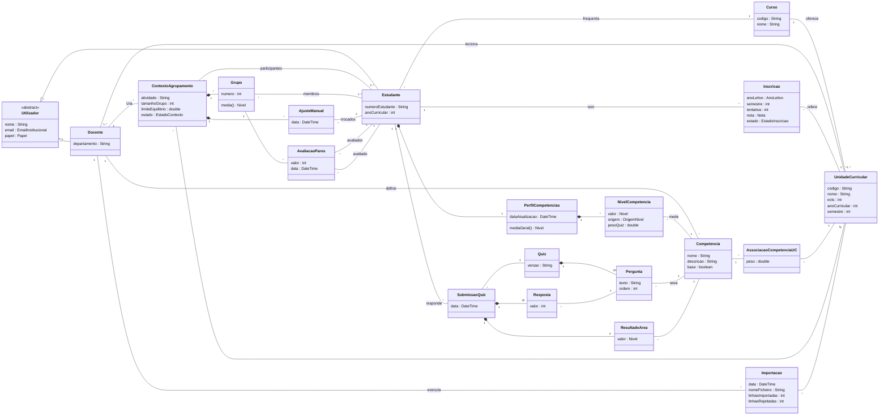
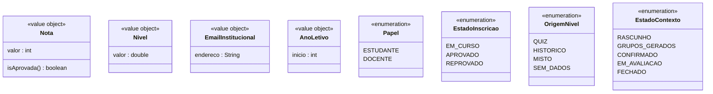

# Modelo de Domínio — StudyMatch

> Sprint 1 · Issue #5 · Grupo 2
> Este modelo resulta da análise dos [casos de uso](casos-de-uso.md) e representa **conceitos do domínio**: não inclui controllers, repositórios nem tabelas.

## 1. Diagrama de classes (UML)

### Tipos de valor e enumerações

## 2. Conceitos

### Identidade
| Conceito | Descrição | UC |
|---|---|---|
| **Utilizador** | Pessoa com conta no sistema. É abstrato: cada utilizador é Estudante ou Docente. | UC01, UC02 |
| **Estudante** | Aluno de um curso, com percurso académico e perfil de competências. | UC01 |
| **Docente** | Professor que leciona UCs, define competências e forma grupos. | UC05, UC10 |
| **Curso** | Licenciatura/mestrado a que pertencem as UCs e os estudantes. | UC01 |

### Trajetória académica
| Conceito | Descrição | UC |
|---|---|---|
| **UnidadeCurricular** | Disciplina de um curso, com ECTS, ano e semestre. | UC03, UC05 |
| **Inscricao** | Uma tentativa de um estudante numa UC num ano letivo. Guarda a nota (opcional enquanto está em curso) e o estado. | UC03, UC04, UC14 |
| **Histórico académico** | Não é uma classe: é o conjunto das inscrições de um estudante. | UC04 |

### Competências e perfil
| Conceito | Descrição | UC |
|---|---|---|
| **Competencia** | Capacidade avaliada de 1 a 5. Há 4 competências **base** (`base = true`), que são as áreas do quiz. | UC05 |
| **AssociacaoCompetenciaUC** | Classe de associação: diz quanto (peso) uma UC contribui para uma competência. | UC05, UC06 |
| **PerfilCompetencias** | Perfil do estudante, com um nível por competência. | UC07 |
| **NivelCompetencia** | Valor atual de uma competência para um estudante, com a origem (quiz, histórico, misto) e o peso do quiz usado. | UC06, UC09 |

### Arranque a frio
| Conceito | Descrição | UC |
|---|---|---|
| **Quiz** | Questionário inicial de 20 perguntas (5 por área). | UC08 |
| **Pergunta** | Pergunta do quiz, associada a uma competência base (a sua área). | UC08 |
| **SubmissaoQuiz** | Resposta completa de um estudante ao quiz numa data. | UC08 |
| **Resposta** | Valor de 1 a 5 dado a uma pergunta. | UC08 |
| **ResultadoArea** | Média das respostas de uma área (1–5), usada como `nivelQuiz`. | UC08, UC09 |

### Agrupamento
| Conceito | Descrição | UC |
|---|---|---|
| **ContextoAgrupamento** | Atividade de uma UC onde se formam grupos: tamanho, participantes, limite de equilíbrio e estado. | UC10 |
| **Grupo** | Conjunto de estudantes formado num contexto; tem média calculada. | UC11, UC13 |
| **AjusteManual** | Registo de uma troca de alunos feita pelo docente. | UC12 |
| **AvaliacaoPares** | Avaliação anónima (1–5) de um membro do grupo a outro. | UC15 |
| **Importacao** | Registo de uma importação CSV de alunos e notas para uma UC. | UC14 |

## 3. Restrições do domínio

1. `Nota.valor` ∈ [0, 20]; `isAprovada()` ⇔ `valor ≥ 10`.
2. `Nivel.valor` ∈ [1, 5].
3. `Inscricao.nota` só pode estar vazia se `estado = EM_CURSO`.
4. Para cada (Estudante, UC), `tentativa` é sequencial e única (1, 2, 3…).
5. `numeroEstudante` e `email` são únicos; o email pertence ao domínio institucional.
6. `AssociacaoCompetenciaUC.peso` ∈ ]0, 1].
7. Existem sempre as 4 competências base: *Organização*, *Gestão de tempo*, *Programação*, *Trabalho em grupo*.
8. Uma `SubmissaoQuiz` tem exatamente 20 respostas e 4 resultados de área.
9. `PerfilCompetencias` tem no máximo um `NivelCompetencia` por competência.
10. `ContextoAgrupamento.tamanhoGrupo` ≥ 2 e ≤ nº de participantes.
11. Num contexto, cada participante pertence a exatamente um grupo, e os tamanhos dos grupos diferem no máximo em 1.
12. `AvaliacaoPares`: avaliador ≠ avaliado; ambos são membros do mesmo grupo; no máximo uma avaliação por par (avaliador, avaliado) por grupo.
13. As avaliações entre pares só são aceites com o contexto `EM_AVALIACAO`.

## 4. Como o modelo suporta o histórico e o perfil

- **Histórico:** cada `Inscricao` é uma tentativa. Por isso, reprovações e melhorias ficam todas guardadas, e a "melhor nota por UC" é derivada, não guardada.
- **Competências a partir das notas:** `AssociacaoCompetenciaUC` liga as UCs às competências com um peso. O `NivelCompetencia` com origem histórica vem das notas das UCs associadas.
- **Cold start:** o `ResultadoArea` do quiz dá o nível inicial das competências base. O `NivelCompetencia.pesoQuiz` guarda quanto o quiz ainda conta, para a transição ser transparente (UC07 mostra a origem).
- **Evolução:** novas competências, outras escalas ou critérios de agrupamento entram como novas classes ou atributos, sem mudar o núcleo (Estudante, UC, Inscrição, Competência).
